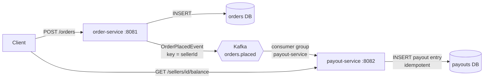

# marketplace-payout


Event-driven backend for a marketplace: buyers place orders, and each seller's payout is computed
asynchronously from the order events, without paying the same order twice.

**Stack:** Java 21 · Spring Boot 3 · Spring Data JPA · PostgreSQL · Apache Kafka · Testcontainers · Docker · GitHub Actions

## Architecture



| Module | Role |
|---|---|
| `events` | Event contracts shared by the services (`OrderPlacedEvent`) |
| `order-service` | REST API to place and read orders; publishes `OrderPlacedEvent` |
| `payout-service` | Consumes the events, splits each amount into commission (10 %) and seller net, exposes seller balances |

## Design decisions

- **Money in integer cents** (`long`) and `BigDecimal` for the commission, never `double`.
- **Kafka key = `sellerId`**: all events of a seller land in the same partition, so they are processed in order.
- **At-least-once delivery + idempotent consumer**: the same event can be delivered twice; the payout service
  checks `orderId` before writing, and a unique constraint in the database is the last line of defence.
- **One database per service**: services only communicate through events.
- **Known limitation, on purpose:** order-service writes to the DB and then sends to Kafka (*dual write*).
  If the commit fails after the send, a ghost event exists. Next step: the **transactional outbox** pattern.

## Run it locally

Prerequisites: JDK 21, Maven 3.9+, Docker Desktop.

```bash
docker compose up -d                              # PostgreSQL x2 + Kafka
mvn -q install -DskipTests                        # build all modules
mvn -pl order-service spring-boot:run             # terminal 1  (port 8081)
mvn -pl payout-service spring-boot:run            # terminal 2  (port 8082)
```

```bash
curl -i -X POST localhost:8081/orders -H 'Content-Type: application/json' \
  -d '{"sellerId":"seller-1","buyerId":"buyer-1","amountCents":2500,"currency":"EUR"}'

curl localhost:8082/sellers/seller-1/balance
# {"sellerId":"seller-1","netCents":2250}
```

## Tests

```bash
mvn verify   # needs Docker running (integration tests use Testcontainers)
```

- Unit tests: `OrderServiceTest`, `CommissionCalculatorTest`, `PayoutServiceTest` (Mockito, no Spring context)
- Web slice: `OrderControllerTest` (`@WebMvcTest`, validation and HTTP status codes)
- Integration: `OrderFlowIntegrationTest`, `PayoutFlowIntegrationTest` (real PostgreSQL + Kafka in Docker),
  including a **duplicate delivery** scenario

## Roadmap

- [ ] Refunds: `OrderRefundedEvent` that reverses the payout
- [ ] Transactional outbox in order-service
- [ ] Dead-letter topic for events that keep failing
- [ ] Flyway migrations instead of `ddl-auto`
- [ ] Angular + TypeScript back-office (orders and seller balances)
- [ ] Dockerfiles for the services + Kubernetes manifests
